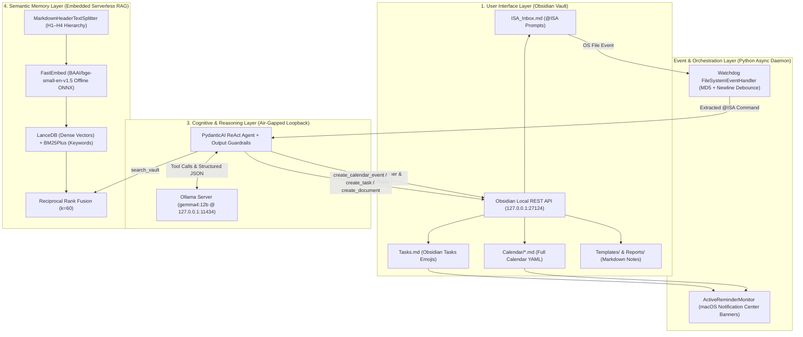

# ISA — Intelligent Secretary Assistant

**ISA (Intelligent Secretary Assistant)** is a local-first, privacy-preserving, air-gapped executive assistant integrated directly into an [Obsidian](https://obsidian.md) vault. Powered by **Google DeepMind's Gemma 4 12B** (served locally via Ollama), **PydanticAI**, **LanceDB**, and **Watchdog**, ISA executes complex administrative and secretarial workflows—including semantic vault research, calendar scheduling, recurring task management, template expansion, and multi-document synthesis—with **zero external network egress**.

---

## Table of Contents

1. [System Architecture](#1-system-architecture)
2. [Key Capabilities](#2-key-capabilities)
3. [Hardware & Quantization Sizing](#3-hardware--quantization-sizing)
4. [Quick Start (Interactive TUI Installer)](#4-quick-start-interactive-tui-installer)
5. [Manual Setup & Configuration](#5-manual-setup--configuration)
6. [Using ISA in Obsidian (`@ISA` Commands)](#6-using-isa-in-obsidian-isa-commands)
7. [Semantic Memory & Hybrid RAG Pipeline](#7-semantic-memory--hybrid-rag-pipeline)
8. [Enforcing the Air-Gap (Application & OS Lockdown)](#8-enforcing-the-air-gap-application--os-lockdown)
9. [CLI Reference & Background Service (`launchd`)](#9-cli-reference--background-service-launchd)
10. [Repository Structure](#10-repository-structure)
11. [Testing & Verification](#11-testing--verification)

---

## 1. System Architecture

ISA is organized into four decoupled subsystems operating asynchronously over the local loopback interface (`127.0.0.1`):



---

## 2. Key Capabilities

- **Reactive Inbox Workflow (`ISA_Inbox.md`)**:
  - Type `@ISA <request>` on a new line in `ISA_Inbox.md` and press `Enter`.
  - ISA immediately injects a live `> [!WARNING] ⏳ ISA is thinking...` status banner showing real-time tool progress (`🔍 Searching vault memory...`, `📅 Creating calendar event...`, `📝 Writing synthesized note...`) and replaces it in-place with a clean `> [!NOTE] ISA Response` callout upon completion.
- **Four-Layer Loop Prevention**:
  - Prevents infinite self-write cascades using (1) monotonic timestamp debouncing, (2) MD5 file checksum tracking, (3) `<!-- ISA_RESPONSE_END -->` delimiter scoping, and (4) newline-gated prompt extraction so Obsidian's background auto-save never triggers mid-sentence.
- **Hybrid RAG Memory (LanceDB + BM25 + RRF)**:
  - Preserves Markdown heading hierarchies (`# H1 > ## H2 > ### H3`), embeds chunks offline using `BAAI/bge-small-en-v1.5` (`384` dimensions), and fuses dense vector similarity with sparse `BM25Plus` keyword search via **Reciprocal Rank Fusion ($k=60$)**.
- **Visual Calendar Scheduling (Obsidian Full Calendar)**:
  - Resolves relative dates (*"tomorrow"*, *"next Tuesday"*) against the injected system clock, validates 24-hour times and real calendar dates, writes YAML frontmatter event notes to `Calendar/`, refreshes the Full Calendar cache, and fires a native macOS notification.
- **Interactive Task & Recurrence Tracking (Obsidian Tasks + macOS Alerts)**:
  - Formats inline tasks with exact emoji signifiers (`📅` due date, `⏳` scheduled date, `🛫` start date, `🔁` recurrence rule, `⏫`/`🔼`/`🔽` priority) in `Tasks.md` and runs a 60-second background scanner that pops up native macOS Notification Center alerts when tasks or meetings are due.
- **Document Synthesis & Templater Integration**:
  - Expands standardized templates from `Templates/` (`Daily Standup Template`, `Meeting Minutes Template`, `Project Brief Template`) or synthesizes multi-note executive summaries while enforcing YAML frontmatter and path-traversal guardrails.

---

## 3. Hardware & Quantization Sizing

ISA is designed around **Gemma 4 12B** (`gemma4:12b`). To maintain low latency and prevent KV-cache out-of-memory (OOM) errors during multi-document synthesis, the context window (`num_ctx`) is constrained to `8,192` tokens by default in [`config/modelfile`](config/modelfile).

| Quantization | Est. File Size | Min VRAM / Unified Memory | Recommended Hardware Profile |
| :--- | :--- | :--- | :--- |
| **FP16** | ~24.0 GB | ~26.0 GB | Mac M-Series Max/Ultra (32GB+) or RTX 5090 |
| **Q8_0** | ~12.7 GB | ~15.0 GB | 16GB–24GB VRAM / Unified Memory |
| **Q5_K_M** | ~8.6 GB | ~10.0 GB | Strong daily driver for 12GB–16GB configurations |
| **Q4_K_M / NVFP4** | ~7.4 GB | ~9.0 GB | **Optimal balance** of reasoning fidelity & speed (8GB–12GB+) |

---

## 4. Quick Start (Interactive TUI Installer)

On a new macOS or Linux machine, run the bootstrap installer script. It sets up the Python virtual environment, installs dependencies, auto-discovers your Obsidian vault, downloads and configures all 4 required Obsidian plugins, generates your `.env` and API key automatically, caches the local embedding model, and indexes your vault into LanceDB:

```zsh
./install_isa.sh
```

### Installer Modes

```zsh
# 1. Interactive 5-Step Rich TUI Setup Wizard (Recommended)
./install_isa.sh

# 2. Headless / Non-Interactive Setup (uses auto-detected vault & defaults)
./install_isa.sh --non-interactive

# 3. Target a specific Obsidian vault path
./install_isa.sh --vault "/Users/yourname/Documents/Obsidian Vault"
```

### What the Installer Provisions Automatically
1. **Virtual Environment (`.venv`)**: Installs `pydantic-ai`, `lancedb`, `watchdog`, `fastembed`, `rank-bm25`, `httpx`, `pydantic-settings`, and `pytest`.
2. **Obsidian Community Plugins (`.obsidian/plugins/`)**:
   - `obsidian-local-rest-api` (Local REST API server on `127.0.0.1:27124`)
   - `obsidian-full-calendar` (Pre-configured to render events from `Calendar/`)
   - `obsidian-tasks-plugin` (Recurring tasks engine & live query blocks)
   - `templater-obsidian` (Pre-configured to load templates from `Templates/`)
3. **Zero-Copy API Key Provisioning**: Reads your existing `OBSIDIAN_API_KEY` from `.obsidian/plugins/obsidian-local-rest-api/data.json`, or generates a cryptographic 64-character hex key and writes it to both `data.json` and `.env`.
4. **Vault Scaffolding**: Creates `Calendar/`, `Templates/` (with 3 starter templates), `Tasks.md` (with an active Tasks dashboard query block), and `ISA_Inbox.md`.

---

## 5. Manual Setup & Configuration

If you prefer to configure `.env` manually:

```zsh
cp .env.example .env
```

### Environment Variables Reference (`.env`)

| Variable | Default | Description |
| :--- | :--- | :--- |
| `OLLAMA_NO_CLOUD` | `1` | Disables all Ollama cloud features and remote fallbacks |
| `OLLAMA_NO_UPDATE_CHECK` | `1` | Disables outbound version checks to GitHub / Ollama registries |
| `OLLAMA_HOST` | `127.0.0.1:11434` | Binds Ollama strictly to the local loopback interface |
| `HF_HUB_OFFLINE` | `1` | Prevents Hugging Face Hub network calls once embeddings are cached |
| `PYDANTIC_AI_NO_BANNER` | `1` | Suppresses startup telemetry banner in PydanticAI |
| `ISA_LLM_BASE_URL` | `http://127.0.0.1:11434/v1` | Loopback OpenAI-compatible inference URL |
| `ISA_LLM_MODEL` | `gemma4:12b` | Local model identifier served by Ollama |
| `ISA_LLM_NUM_CTX` | `8192` | Maximum context window tokens (`num_ctx`) |
| `OBSIDIAN_API_URL` | `https://127.0.0.1:27124` | Loopback URL for the Obsidian Local REST API plugin |
| `OBSIDIAN_API_KEY` | *(64-char hex)* | Bearer token from Obsidian Local REST API settings |
| `OBSIDIAN_VERIFY_SSL` | `false` | Disables strict CA check for Obsidian's self-signed localhost cert |
| `OBSIDIAN_VAULT_PATH` | `/path/to/vault` | Absolute filesystem path to your Obsidian vault |
| `ISA_INBOX_FILENAME` | `ISA_Inbox.md` | Designated inbox note monitored by `watchdog` |
| `ISA_ACTIVE_TASKS_FILENAME` | `Tasks.md` | Target note for inline tasks and dashboard queries |
| `ISA_CALENDAR_FOLDER` | `Calendar` | Vault folder watched by Obsidian Full Calendar |
| `ISA_DEBOUNCE_SECONDS` | `1.0` | Minimum debounce window between file-modification events |
| `LANCEDB_URI` | `./data/lancedb` | Local directory for serverless LanceDB tables |
| `ISA_EMBEDDING_MODEL` | `BAAI/bge-small-en-v1.5` | Local FastEmbed ONNX model cached in `./data/models` |
| `ISA_RRF_K` | `60` | Smoothing constant $k$ for Reciprocal Rank Fusion |
| `ISA_CONTEXT_WINDOW_SIZE` | `10` | Number of recent conversation entries retained in `data/rolling_context.json` |

---

## 6. Using ISA in Obsidian (`@ISA` Commands)

Open **`ISA_Inbox.md`** in Obsidian, type a command starting with `@ISA`, and **press `Enter`** (creating a newline after your prompt tells ISA you have finished typing).

### Example Prompts by Workflow

#### A. Vault Search & Q&A (Hybrid RAG)
```markdown
@ISA Search my vault for notes about our blog strategy and summarize the key points.
```

#### B. Calendar Event Scheduling (Obsidian Full Calendar)
```markdown
@ISA Schedule a 1-on-1 performance review with Alice for tomorrow from 10 AM to 11 AM.
```
*Creates `Calendar/2026-10-22 - 1-on-1 Performance Review with Alice.md` with validated YAML frontmatter, refreshes the Full Calendar view inside Obsidian, and pops up a macOS notification.*

#### C. Task & Recurring Reminder Management (Obsidian Tasks)
```markdown
@ISA Remind me to submit the weekly budget report every Friday, due this Friday, mark it high priority.
```
*Appends `- [ ] submit the weekly budget report 🔁 every week on Friday 📅 2026-10-23 ⏫` to `Tasks.md` and triggers a macOS reminder alert.*

#### D. Template Instantiation (Obsidian Templater)
```markdown
@ISA Create a new daily standup note for today at Standups/2026-10-21 Standup.md using the Daily Standup Template.
```

#### E. Multi-Document Synthesis
```markdown
@ISA Read my blog notes and create a synthesized executive overview at Reports/Blog Overview.md.
```

#### F. Full Task & Calendar Lifecycle (Complete, Update, Reschedule, Cancel)
```markdown
@ISA Mark "Review the quarterly report" as completed.
@ISA Move the "Call the accountant" task to next Wednesday and mark it high priority.
@ISA Reschedule my Executive Strategy Meeting to 2026-10-28 from 15:00 to 16:00.
```

#### G. Instant Fast-Path Slash Commands (`< 1s`, No LLM Latency)
```markdown
@ISA /briefing   # Generates Briefings/YYYY-MM-DD - Executive Briefing.md combining today's events, tasks, and recent meetings
@ISA /archive    # Archives older ISA_Inbox.md exchanges into Archive/ISA_Transcript_YYYY-MM.md (keeping the last 2 visible)
@ISA /clear      # Wipes ISA_Inbox.md back to a completely clean slate with a fresh @ISA prompt line
@ISA /rescan     # Forces a full vault LanceDB re-index with macOS desktop notification
```

---

## 7. Semantic Memory & Hybrid RAG Pipeline

1. **Context-Aware Markdown Splitting ([`src/memory/ingest.py`](src/memory/ingest.py))**:
   - `MarkdownHeaderTextSplitter` splits `.md` notes strictly along `# H1` through `#### H4` boundaries while preserving the full parent-child breadcrumb path (e.g., `Annual Plan > Q4 Marketing > Campaign Metrics`) and ignoring `#` comments inside fenced code blocks (`` ``` ``).
2. **Dense + Sparse Hybrid Retrieval ([`src/memory/vector_db.py`](src/memory/vector_db.py))**:
   - **Dense Semantic Search**: Queries 384-dimensional `BAAI/bge-small-en-v1.5` embeddings in LanceDB to capture conceptual similarity.
   - **Sparse Keyword Search (`BM25Plus`)**: Scores exact token matches (project codenames, serial numbers, dates) across the vault.
3. **Reciprocal Rank Fusion (RRF)**:
   - Reconciles dense and BM25 rankings without arbitrary weight tuning:
     $$\text{RRF\_Score}(d) = \sum_{r \in \{\text{dense}, \text{bm25}\}} \frac{1}{k + \text{rank}_r(d)} \quad (k = 60)$$
4. **Rolling 10-Entry Conversational Context Window ([`src/memory/context_window.py`](src/memory/context_window.py))**:
   - Retains the most recent 10 `(user_prompt, assistant_response)` exchanges in a fixed-capacity FIFO window persisted at `data/rolling_context.json` (and self-heals or resets cleanly via `./start_isa.sh --clear-memory`).

---

## 8. Enforcing the Air-Gap (Application & OS Lockdown)

1. **Application-Level Controls**:
   - [`config/settings.py`](config/settings.py) and [`start_isa.sh`](start_isa.sh) enforce `OLLAMA_NO_CLOUD=1`, `OLLAMA_NO_UPDATE_CHECK=1`, `OLLAMA_HOST=127.0.0.1:11434`, `HF_HUB_OFFLINE=1`, `COPILOT_OFFLINE=true`, and `OPENCODE_AIRGAPPED=1`.
   - Both [`ObsidianRestClient`](src/tools/obsidian.py) and [`build_local_model()`](src/agent.py) validate at initialization that target URLs resolve strictly to loopback (`127.0.0.1`, `localhost`, `::1`), raising an `Air-gap violation` `ValueError` otherwise.
2. **OS-Level Firewall Lockdown**:
   - Ensure Ollama is started bound only to loopback:
     ```zsh
     OLLAMA_NO_CLOUD=1 OLLAMA_NO_UPDATE_CHECK=1 OLLAMA_HOST=127.0.0.1:11434 ollama serve
     ```
   - On **macOS**, use Little Snitch, LuLu, or `pf` (`pfctl`) to block outbound non-loopback connections for `/opt/homebrew/bin/ollama` and `.venv/bin/python`, allowing traffic solely on `lo0` (`127.0.0.1`).
   - On **Linux**, restrict egress via `ufw` or `iptables` to `127.0.0.1`.

---

## 9. CLI Reference & Background Service (`launchd`)

### Command-Line Flags (`start_isa.sh`)

```zsh
# Verify air-gap environment variables, LanceDB, Obsidian REST API, and local LLM
./start_isa.sh --check

# Re-index all Markdown notes in the Obsidian vault into LanceDB
./start_isa.sh --ingest

# Profile vault ingestion speed, Hybrid RRF query latency, and RSS memory footprint
./start_isa.sh --profile

# Process a single pending @ISA command in ISA_Inbox.md and exit
./start_isa.sh --once

# Clear the rolling 10-entry context window (data/rolling_context.json) for a clean slate
./start_isa.sh --clear-memory

# Clear the ISA_Inbox.md page back to a clean slate
./start_isa.sh --clear-inbox

# Start with manual trigger mode (triggers on pressing Enter after your prompt; ignores punctuation)
./start_isa.sh --manual-trigger

# Start with auto trigger mode (triggers on terminal punctuation [.!?] + Enter or Enter twice)
./start_isa.sh --auto-trigger

# Run the continuous Watchdog + Active Reminder daemon (Interactive prompt for trigger mode)
./start_isa.sh
```

### Running as a macOS Autostart Service (`launchd`)

To run ISA automatically in the background whenever you log into macOS:

```zsh
cp config/com.isa.assistant.plist ~/Library/LaunchAgents/
launchctl load ~/Library/LaunchAgents/com.isa.assistant.plist
```

Logs are written to `data/isa_daemon.out.log` and `data/isa_daemon.err.log`. To stop the service:

```zsh
launchctl unload ~/Library/LaunchAgents/com.isa.assistant.plist
```

---

## 10. Repository Structure

```text
ISA-Agent/
├── .env.example                 # Template environment configuration
├── .gitignore                   # Excludes .venv, .env, and local LanceDB data/
├── ISA_Arechitecture_Blueprint.md # Full architectural specification & 12-week roadmap
├── README.md                    # Project documentation
├── install_isa.sh               # Cross-machine bootstrap & Rich TUI installer launcher
├── requirements.txt             # Locked Python dependencies
├── start_isa.sh                 # Air-gap enforcement wrapper & daemon launcher
├── config/
│   ├── __init__.py
│   ├── com.isa.assistant.plist  # macOS launchd background daemon definition
│   ├── modelfile                # Ollama Modelfile (gemma4:12b, num_ctx=8192)
│   └── settings.py              # Pydantic Settings & air-gap env enforcement
├── src/
│   ├── __init__.py
│   ├── agent.py                 # PydanticAI ReAct loop, thinking banner, & tool defs
│   ├── installer_tui.py         # Interactive Rich TUI setup wizard
│   ├── main.py                  # CLI entry point & async watchdog/reminder event loop
│   ├── memory/
│   │   ├── __init__.py
│   │   ├── context_window.py    # Rolling 10-entry conversational context window & JSON persistence
│   │   ├── ingest.py            # MarkdownHeaderTextSplitter & offline FastEmbed
│   │   └── vector_db.py         # Embedded LanceDB store, BM25Plus, & RRF fusion
│   ├── monitor/
│   │   ├── __init__.py
│   │   └── observer.py          # Watchdog FileSystemEventHandler & loop prevention
│   └── tools/
│       ├── __init__.py
│       ├── calendar.py          # Obsidian Full Calendar YAML validation & creation
│       ├── documents.py         # Document synthesis, Templater, & syntax guardrails
│       ├── notifications.py     # macOS Notification Center alerts & due-item scanner
│       ├── obsidian.py          # Async Obsidian Local REST API client (loopback-only)
│       └── tasks.py             # Obsidian Tasks inline emoji formatting & validation
└── tests/
    ├── test_agent.py            # Unit tests for air-gap, RRF, chunking, & Hybrid RAG
    └── test_tools.py            # Unit tests for REST client, debounce, Calendar, Tasks, & TUI
```

---

## 11. Testing & Verification

Run the automated test suite using `pytest`:

```zsh
.venv/bin/python -m pytest -v
```

Run the live end-to-end connectivity and air-gap check:

```zsh
./start_isa.sh --check
```
